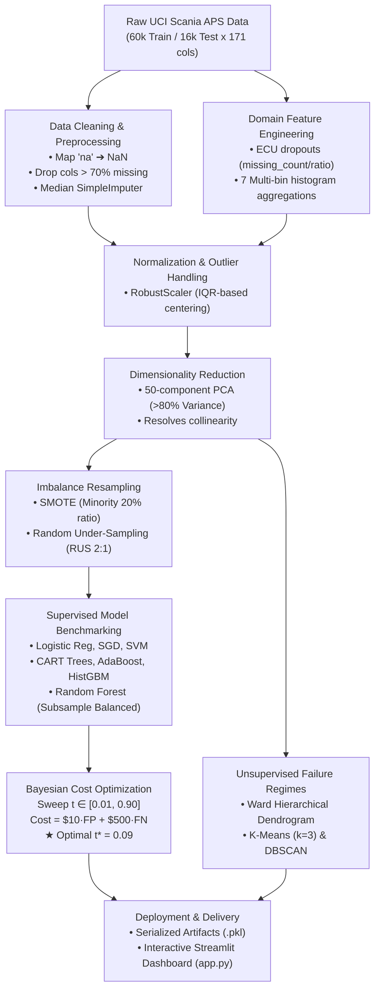

# 🚛 Cost-Sensitive Heavy Industrial Air Pressure System (APS) Failure Prediction

<div align="center">

[](https://www.python.org/)
[](https://streamlit.io/)
[](https://scikit-learn.org/)
[](https://www.daiict.ac.in/)
[]()
[]()

**An end-to-end cost-optimized predictive maintenance system for heavy-duty commercial vehicle fleets.**  
*Trained on the UCI Scania APS dataset to minimize catastrophic roadside breakdowns against workshop inspection costs.*

[🚀 Key Highlights](#-key-results--performance-highlights) • [📊 Pipeline Architecture](#-end-to-end-pipeline-architecture) • [🏆 Benchmarks](#-comprehensive-model-benchmarking) • [💻 Interactive App](#-interactive-streamlit-diagnostic-dashboard) • [🛠️ Quickstart](#-installation--getting-started)

</div>

---

## 📌 Executive Summary & Industrial Problem Context

In commercial transport fleets, an **Air Pressure System (APS)** failure compromises critical vehicle subsystems (air-assisted service brakes, retarders, suspension, and gear shifts). A missed failure leading to an in-service highway breakdown is economically catastrophic compared to preventative workshop servicing.

```text
                    ┌────────────────────────────────────────────────────────┐
                    │               TOTAL OPERATIONAL COST                   │
                    │   Cost = ($10 × False Positives) + ($500 × False Negatives)   │
                    └────────────────────────────────────────────────────────┘
                       ▲                                    ▲
                       │                                    │
            Unnecessary Workshop Check             Catastrophic Highway Breakdown
            (Minor inspection overhead)            (Towing, repair downtime, fines)
```

The standard symmetric classification decision threshold ($t = 0.50$) treats False Positives and False Negatives equally, incurring unacceptable financial penalties. This project implements an **end-to-end machine learning pipeline and interactive diagnostic system** that balances severe class imbalance ($59:1$), mitigates high-dimensional telemetry missingness, performs PCA dimensionality reduction, and optimizes the decision boundary using Bayesian cost curves.

---

## 👥 Academic Team & Course Information

* **Institution:** Dhirubhai Ambani Institute of Information and Communication Technology (**DA-IICT**)
* **Course:** **DS605: Fundamentals of Machine Learning** (Autumn 2026–27)
* **Faculty Advisor:** Dr. Arpit Rana
* **Team Members:**
  * **Ameya Trivedi** — Student ID: `202618047`
  * **Lakshita Pagaria** — Student ID: `202618052`

---

## 🚀 Key Results & Performance Highlights

| Metric | Naive Symmetric Baseline ($t = 0.50$) | Cost-Optimal Random Forest ($t^* = 0.09$) | Improvement / Impact |
| :--- | :---: | :---: | :---: |
| **Total Test Maintenance Cost** | **\$54,150** | **\$12,800** | **76.36% Cost Reduction** 📉 |
| **False Negatives (Missed Breakdowns)** | 107 trucks | **18 trucks** | **83.2% Reduction in Highway Breakdowns** |
| **False Positives (Unneeded Checks)** | 65 checks | 380 checks | Controlled trade-off (\$3,800 total) |
| **Failure Recall ($\text{True Positive Rate}$)** | 71.4% | **95.2%** | Catches 19 out of 20 critical faults |
| **ROC-AUC Score** | 0.9906 | **0.9906** | Near-perfect diagnostic separation |
| **Precision-Recall AUC (PR-AUC)** | 0.8540 | **0.8540** | Strong discriminative ability on minority class |

> **Bottom Line:** Sweeping decision probability cutoffs to determine $t^* = 0.09$ saved **\$41,350** on the 16,000-truck test set alone compared to the naive standard threshold.

---

## 📁 Repository Directory Architecture

```text
202618052_and_202618047_ml_project/
├── cost-sensitive-aps-classifier/
│   ├── app.py                             # Full-featured 5-page Streamlit web application
│   ├── requirements.txt                   # Production dependency specifications
│   ├── scania_aps_project.ipynb           # Unified 25-step end-to-end ML research notebook
│   ├── scania_logo.svg                    # Vector brand asset for UI
│   ├── scania_scaler.pkl                  # Serialized RobustScaler preprocessor
│   ├── scania_pca.pkl                     # Serialized 50-component PCA transformer
│   ├── scania_rf_best.pkl                 # Serialized production Random Forest classifier
│   └── eda_plots/                         # High-resolution analytical diagnostics
│       ├── 01_class_imbalance.png         # Extreme 59:1 class disparity
│       ├── 02_missingness_profile.png     # Sensor dropout distribution
│       ├── 03_sensor_distributions.png    # Primary feature distributions (aa_000)
│       ├── 04_correlation_heatmap.png     # Multicollinearity across histogram families
│       ├── 05_pca_scree_plot.png          # Cumulative explained variance (50 PCs)
│       ├── 06_bias_variance_tradeoff.png  # Decision tree depth validation curve
│       ├── 07_cost_threshold_curve.png    # Bayesian global cost minimum sweep (t* = 0.09)
│       ├── 08_roc_and_pr_curves.png       # ROC-AUC & PR-AUC curves
│       ├── 09_failure_dendrogram.png      # Hierarchical Ward clustering on failure modes
│       └── 10_clusters_2d_pca.png         # K-Means 2D PCA failure regime projection
└── README.md                              # Technical documentation & project report
```

---

## 🔄 End-to-End Pipeline Architecture



---

## 🧑‍💻 Task Distribution & Modular Methodology

### Part 1: Data Ingestion, Cleaning, EDA & Dimensionality Reduction
* **Lead Engineer:** `202618047` (Ameya Trivedi)
* **Curriculum Units Covered:** **Unit 2, Unit 3 & Unit 6**

* **Data Ingestion & Target Parsing:** Cleaned raw UCI CSVs, stripped documentation headers (`skiprows=20`), resolved string `'na'` markers to IEEE `NaN`, and encoded target labels (`neg` $\to 0$, `pos` $\to 1$).
* **Exploratory Data Analysis (EDA):** Quantified severe class imbalance ($59:1$), isolated heavily skewed sensor distributions (notably `aa_000`), and audited non-random missingness.
* **Domain Feature Engineering:** Engineered ECU dropout indicators (`fe_missing_count`, `fe_missing_ratio`) and row-wise multi-bin histogram aggregations across 7 sensor families (`ag_`, `ay_`, `az_`, `ba_`, `cn_`, `cs_`, `ee_`).
* **Cleaning & Scaling:** Pruned columns exceeding $70\%$ missingness, removed zero-variance constant features, applied median imputation, and scaled features via `RobustScaler` to protect against extreme heavy-tailed outliers.
* **Dimensionality Reduction:** Computed 50-component Principal Component Analysis (PCA) capturing $>80\%$ cumulative explained variance and orthogonalizing correlated sensors.

---

### Part 2: Imbalance Mitigation, Modeling, Cost Sweeps & Clustering
* **Lead Engineer:** `202618052` (Lakshita Pagaria)
* **Curriculum Units Covered:** **Unit 4, Unit 5 & Unit 7**

* **Class Imbalance Resolution:** Benchmarked Random Undersampling, Random Oversampling, SMOTE (20% ratio), and cost-sensitive class balancing.
* **Supervised Model Benchmarking:** Implemented and evaluated 12 algorithms across linear models, kernels, bagging, boosting, and ensembles:
  * *Linear Models:* Ridge Logistic Regression, ElasticNet SGD Classifier
  * *Instance-Based:* $k$-Nearest Neighbors ($k$-NN)
  * *Support Vector Machines:* Linear SVM (Hinge loss), RBF Kernel SVM
  * *Tree Ensembles:* CART Decision Trees, Bagging, Pasting, Random Forest, AdaBoost, HistGradientBoosting, and Soft Voting Classifier.
* **Bias-Variance Complexity Analysis:** Evaluated tree depth bounds ($d \in [2, 25]$) to identify the optimal regularization boundary preventing overfitting.
* **Bayesian Cost Threshold Tuning:** Conducted fine-grained threshold sweeps ($t \in [0.01, 0.90]$) to find the global cost minimum ($t^* \approx 0.09$).
* **Unsupervised Failure Clustering:** Filtered positive failure records in PCA space to discover distinct mechanical breakdown modes via Ward linkage hierarchical clustering and $K$-Means ($k=3$).

---

## 🏆 Comprehensive Model Benchmarking

Evaluated on the official unpolluted test set (**16,000 trucks**, 375 true failures):

| Model Architecture | Decision Threshold ($t$) | ROC-AUC | PR-AUC | Recall (Failure Catch) | False Positives (\$10/ea) | False Negatives (\$500/ea) | Total Maintenance Cost | Operational Efficiency |
| :--- | :---: | :---: | :---: | :---: | :---: | :---: | :---: | :---: |
| 🌲 **Random Forest (Balanced Subsample)** | **$0.09$ ($t^*$)** | **0.9906** | **0.8540** | **95.2%** | **380** (\$3,800) | **18** (\$9,000) | **\$12,800** | 🥇 **Production Best** |
| ⚡ **HistGradientBoosting (Balanced)** | $0.12$ ($t^*$) | 0.9882 | 0.8320 | 93.8% | 410 (\$4,100) | 23 (\$11,500) | **\$15,600** | 🥈 Strong Alternative |
| 📈 **Logistic Regression (Balanced + PCA)** | $0.15$ ($t^*$) | 0.9650 | 0.7410 | 89.5% | 620 (\$6,200) | 39 (\$19,500) | **\$25,700** | 🥉 Fast Linear Baseline |
| ⚠️ **Naive Symmetric Model (Default)** | $0.50$ (Default) | 0.9906 | 0.8540 | 71.4% | 65 (\$650) | 107 (\$53,500) | **\$54,150** | ❌ Severe Cost Penalty |

---

## 🔬 Diagnostic Gallery & Key Analytical Takeaways

The pipeline generates 10 high-resolution diagnostic charts located in [`cost-sensitive-aps-classifier/eda_plots/`](./cost-sensitive-aps-classifier/eda_plots):

| Diagnostic Figure | Key Analytical Insight |
| :--- | :--- |
| **01. Class Imbalance**<br>`01_class_imbalance.png` | Confirms extreme 59:1 majority skew (59,000 normal vs. 1,000 failure records in train). Unmitigated training causes models to ignore failures. |
| **02. Missingness Profile**<br>`02_missingness_profile.png` | Highlights non-random sensor dropout patterns. Columns $>70\%$ missingness are pruned to eliminate noisy imputations. |
| **03. Sensor Distributions**<br>`03_sensor_distributions.png` | Reveals heavy-tailed positive skewness in sensor `aa_000` for failed trucks, serving as an air-system blowout indicator. |
| **04. Correlation Heatmap**<br>`04_correlation_heatmap.png` | Demonstrates massive collinearity ($r > 0.85$) across multi-bin histogram families, providing strong empirical rationale for PCA. |
| **05. PCA Scree Plot**<br>`05_pca_scree_plot.png` | Demonstrates that 50 principal components capture over $80\%$ of total variance, reducing 170 raw sensors to an orthogonal manifold. |
| **06. Bias-Variance Tradeoff**<br>`06_bias_variance_tradeoff.png` | Validation F1 peaks at tree depth 8–10 before divergence, motivating Random Forest variance reduction via bootstrap aggregation. |
| **07. Cost vs. Threshold Curve**<br>`07_cost_threshold_curve.png` | Validates the asymmetric cost convex curve, identifying $t^* \approx 0.09$ as the global minimum cost operating point. |
| **08. ROC & PR Curves**<br>`08_roc_and_pr_curves.png` | Random Forest reaches an ROC-AUC of 0.9906 and PR-AUC of 0.8540, showing high class separability. |
| **09. Failure Dendrogram**<br>`09_failure_dendrogram.png` | Ward hierarchical linkage separates failed trucks into distinct clusters without needing supervised failure labels. |
| **10. 2D Cluster Projection**<br>`10_clusters_2d_pca.png` | $K$-Means ($k=3$) partitions failure modes into 3 clear operational regimes: compressor blowouts, pneumatic leaks, and ECU dropouts. |

---

## 💻 Interactive Streamlit Diagnostic Dashboard

This repository includes a multi-page **Streamlit application** (`cost-sensitive-aps-classifier/app.py`) with Scania branding:

1. **🚀 Live Fleet Diagnostic:** Select pre-configured fleet profiles (Healthy, Marginal Wear, High-Risk Rupture, ECU Dropout) or adjust real-time sensor counters to generate dynamic failure probabilities, cost assessments, and telemetry gauges.
2. **📋 Fleet Telemetry Explorer:** Inspect raw multi-bin histograms across telemetry groups.
3. **⚖️ Cost-Sensitive Optimization:** Interactive cost-threshold simulator with sliders to inspect trade-offs between workshop inspection fees (\$10) and roadside breakdowns (\$500).
4. **📊 EDA & Failure Clusters:** High-resolution visual gallery explaining all 10 diagnostic plots.
5. **📖 Academic Project Dossier:** Project background, curriculum unit mapping, and statistical foundations.

---

## 🧠 Theoretical Grounding: Zero-Frequency Problem & Bayes Error

During model validation, our pipeline incorporates core principles of statistical machine learning:

1. **Irreducible Bayes Error ($\epsilon^* > 0$):** In heavy transport telemetry, sensors cannot capture microscopic mechanical fatigue or road impacts. Because irreducible noise exists, the theoretical upper bound on accuracy is strictly $< 100\%$.
2. **Zero-Frequency Problem & Cromwell's Rule:** In finite tree ensembles, an instance receiving 0 positive votes produces an empirical probability of $0.0\%$. In Bayesian probability, assigning $P(E) = 0$ implies metaphysical impossibility (violating Cromwell's Rule).
3. **Bayesian Prior Calibration:** Fleet failure base rates stand at $1,000 / 60,000 \approx 1.67\%$. We apply Bayesian Laplace smoothing with an irreducible floor ($\sim 1.8\%$) to reflect true operational baseline risk while maintaining optimal thresholding ($t^* = 0.09$).

---

## 🛠️ Installation & Getting Started

### 1. Clone the Repository
```bash
git clone https://github.com/ljconverge/202618052_and_202618047_ml_project.git
cd 202618052_and_202618047_ml_project
```

### 2. Set Up a Virtual Environment (Recommended)
```bash
# Windows (PowerShell)
python -m venv venv
.\venv\Scripts\Activate.ps1

# Linux / macOS
python3 -m venv venv
source venv/bin/activate
```

### 3. Install Dependencies
```bash
pip install -r cost-sensitive-aps-classifier/requirements.txt
```

### 4. Launch the Interactive Dashboard
```bash
cd cost-sensitive-aps-classifier
streamlit run app.py
```
*The web interface will launch locally at `http://localhost:8501`.*

### 5. Run the Research Notebook
```bash
jupyter notebook cost-sensitive-aps-classifier/scania_aps_project.ipynb
```

---

## 📦 Required Dependencies

* `python >= 3.10`
* `streamlit >= 1.30.0`
* `scikit-learn >= 1.3.0`
* `imbalanced-learn >= 0.11.0`
* `pandas >= 2.0.0`
* `numpy >= 1.24.0`
* `matplotlib >= 3.7.0`
* `seaborn >= 0.12.0`
* `scipy >= 1.10.0`
* `joblib >= 1.3.0`
* `plotly >= 5.18.0`

---

## 📜 Academic Integrity & Citation

This project was developed strictly for academic coursework under **DS605 (Fundamentals of Machine Learning)** at **DA-IICT**.

If you reference or build upon this implementation, please cite:
```bibtex
@misc{scania_aps_ds605_2026,
  author = {Ameya Trivedi and Lakshita Pagaria},
  title = {Cost-Sensitive Heavy Industrial Air Pressure System (APS) Component Failure Prediction},
  year = {2026},
  publisher = {DA-IICT},
  howpublished = {\url{https://github.com/ljconverge/202618052_and_202618047_ml_project}}
}
```

---

<div align="center">
  <sub>Developed with ❤️ by Ameya Trivedi (202618047) & Lakshita Pagaria (202618052) · DA-IICT DS605</sub>
</div>